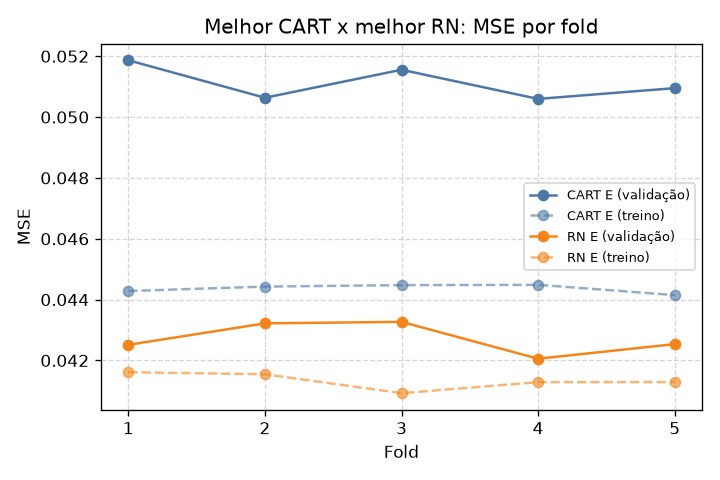
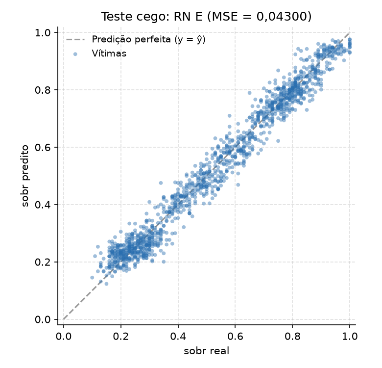

# Victim Triage with Machine Learning

Machine learning models (decision trees and neural networks) for triage of accident victims in rescue scenarios, using only vital signs and physical injuries as input.

Two tasks were solved on the same synthetic dataset:

- **Classification** – predict the START triage class (green, yellow, red, black)
- **Regression** – predict the victim's probability of survival (0 to 1)

> Academic project developed for the *Sistemas Inteligentes* course at UTFPR. Code and comments are in Portuguese.

---

## Results

All results below come from a **blind test set of 1,300 victims**, never used during training or model selection.

### Classification – triage class

| Model | Accuracy | F1 (macro) | Precision (macro) | Recall (macro) |
|---|---|---|---|---|
| Decision Tree (CART) | 93.4% | 0.933 | 0.934 | 0.932 |
| **Neural Network (MLP)** | **94.2%** | **0.941** | **0.941** | **0.941** |

### Regression – survival probability

| Model | MSE | RMSE |
|---|---|---|
| Decision Tree (CART) | 0.0520 | 0.228 |
| **Neural Network (MLP)** | **0.0430** | **0.207** |

The neural network reduced the error by **17.3% (MSE)** compared to the decision tree.



| Decision Tree – predicted vs. real | Neural Network – predicted vs. real |
|---|---|
|  |  |

---

## Approach

1. **Dataset** – 10,000 synthetic victims balanced across triage classes (training/validation) and 1,300 victims for the blind test, generated with a different seed.
2. **Inputs** – 10 features: age, heart rate, respiratory rate, systolic blood pressure, SpO₂, temperature, radial pulse, bleeding, open fracture and burns. Glasgow score, AVPU and the triage class itself were **not** allowed as inputs.
3. **Models** – for each algorithm, three configurations were trained on purpose: underfitted, balanced and overfitted.
4. **Validation** – 5-fold cross-validation (stratified for classification), comparing training vs. validation scores to diagnose bias and variance.
5. **Model selection** – the best model was the one with the highest validation score among those whose train–validation gap stayed small.
6. **Final evaluation** – the selected models were retrained on the full training set and evaluated once on the blind test set.

### Selected hyperparameters

| Task | Decision Tree | Neural Network |
|---|---|---|
| Classification | max_depth=8, min_samples_leaf=10, criterion=entropy | layers (32, 16), ReLU, Adam, alpha=0.001, early stopping |
| Regression | max_depth=10, min_samples_leaf=20 | layers (32, 16), tanh, Adam, alpha=0.001, early stopping, StandardScaler |

---

## Project structure

```
victim-triage-ml/
├── classification/
│   ├── config.py                  # shared settings (seed, folds, features)
│   ├── etapa1_gerar_dataset.py    # dataset generation
│   ├── etapa2_cart.py             # decision tree models
│   ├── etapa3_rn.py               # neural network models
│   ├── etapa4_comparacao.py       # model comparison and selection
│   ├── etapa5_teste_cego.py       # blind test
│   ├── validacao_cruzada.py
│   ├── datasets/                  # generated data
│   ├── resultados/                # metrics (JSON)
│   └── relatorio.pdf              # full report (Portuguese)
└── regression/
    ├── config.py
    ├── etapa1_gerar_dataset.py
    ├── etapa2_cart.py
    ├── etapa3_rn.py
    ├── etapa4_comparacao.py
    ├── etapa5_retreino.py         # retraining of the selected models
    ├── etapa6_teste_cego.py       # blind test
    ├── gerar_teste_cego.py
    ├── validacao.py
    ├── modelos/                   # trained models (.joblib)
    ├── resultados/                # metrics (CSV) and charts
    └── relatorio.pdf
```

## How to run

```bash
pip install -r requirements.txt

# Classification
cd classification
python etapa1_gerar_dataset.py
python etapa2_cart.py
python etapa3_rn.py
python etapa4_comparacao.py
python etapa5_teste_cego.py

# Regression
cd ../regression
python etapa1_gerar_dataset.py
python etapa2_cart.py
python etapa3_rn.py
python etapa4_comparacao.py
python etapa5_retreino.py
python gerar_teste_cego.py
python etapa6_teste_cego.py
```

All scripts must be run from inside their own folder. A fixed random seed (42) is used for reproducibility.

## Credits

- Data generation scripts (`gerar_dados_vitimas.py`, `gerar_mapa_exploracao.py`, `gerar_regioes_densas_nao_convexas.py`) were provided by Prof. Tacla for the course.
- Developed by Bianca Miyazato.

---

## 🇧🇷 Versão em português

Modelos de aprendizado de máquina (árvore de decisão e rede neural) para triagem de vítimas de acidentes, usando apenas sinais vitais e lesões como entrada. O projeto resolve duas tarefas: **classificar** a gravidade pela triagem START e **prever** a probabilidade de sobrevivência. No teste cego com 1.300 vítimas, a rede neural foi o melhor modelo nas duas tarefas: **94,2% de acurácia** na classificação e **MSE 17,3% menor** que a árvore na regressão. Trabalho acadêmico da disciplina de Sistemas Inteligentes (UTFPR).
